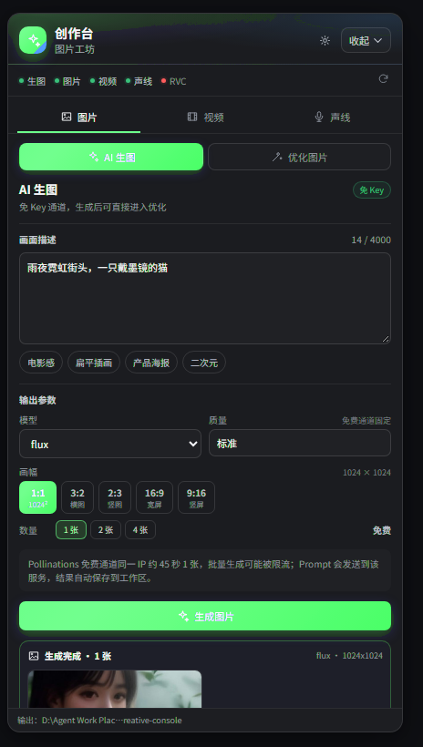

# MuRaSame 创作助手

> 在 DeepSeek Harness 左侧栏里，把生图、视频、配音、字幕和成品归档串成一个可被 Agent 调用的创作工作流。
>
> 制作者：**丛雨不善言辞** ｜ 版本：**1.23.0** ｜ License：MIT

[](https://github.com/CYBSYC-Nya/MuRaSame)
[](https://github.com/CYBSYC-Nya/MuRaSame)
[](LICENSE)
[](https://github.com/CYBSYC-Nya/MuRaSame/actions/workflows/ci.yml)

MuRaSame 不是一个“多几个按钮”的素材面板。它把本机创作引擎、DeepSeek Harness 的 Agent 循环和 12 个 `creative_*` 工具接在一起：用户给目标，Agent 先计划，再调用工具，校验生成的文件，最后把成品存进项目。



## 它能做什么

### 图片工坊

- 支持 **Pollinations**（免 Key）、**Seedream / 火山方舟**、**SiliconFlow**、**通义万相 DashScope**、任意 OpenAI 兼容 `/images/generations`
- 1—4 张批量生成，生成结果可直接送入优化或超分
- **Real-ESRGAN ncnn Vulkan** 本地超分：2×/3×/4×，照片与二次元模型
- WebP / JPEG / PNG / AVIF 转换、压缩、裁切，适合网页和课件
- 生图 API 支持“测试连接”，可读取模型列表，错误会显示 HTTP/网络原因

### 视频剪辑

- **按描述剪**：输入“保留人物说话、去掉空镜、总长约 30 秒”，模型抽帧并结合台词选段
- 方案预览：逐段查看时间段和理由，可直接改入点/出点、移除某段、撤销上一步
- **台词级剪辑**：粘贴 SRT/台词，或配置 ASR API 自动转写
- 多段时间线排序，统一 1080p / 720p / 9:16 / 1:1 / 跟随原片
- 字幕：SRT 软封装、逐句 TTS 配音、一键字幕配音
- 导出 MP4，或导出 **FCP XML** 交给 Premiere；不连接、不修改正在运行的 PR 工程

### 声线实验室

- 20 个 Edge 神经声线、10 种 RVC 风格音色
- 语速、音高、音量可调，合成 MP3 时同步生成 SRT
- 录音/上传 5—10 秒样本，选目标声线与本地 RVC 模型，转换试听后保存为自定义预设
- 自定义预设支持试听、重命名、删除；保存时绑定的 RVC 模型会随预设复用

### 成品与项目

- 最近成品统一列表：图片、视频、音频、字幕
- 成品可加入命名项目；项目只保存文件引用，不复制大文件
- 项目增删条目会留下最多 **20 版快照**，可恢复上一版
- 一键打开成品所在文件夹；目录访问限制在插件输出根目录

### API 与可靠性

- 生图 / 语言 / ASR 三条 API 分别测试
- 语言测试会发一个 1 token 的真实请求，并返回协议与延迟
- DeepSeek 自动走 Anthropic Messages；其他兼容端点走 OpenAI Chat Completions
- Key 存入 DSH 凭据，不写进配置文件；输出自动落到工作区 `.creative-console/`

## Agent 能力

插件注册 **12 个** DSH 工具，Agent 可以在对话里直接完成一条创作链：

| 工具 | 用途 |
|---|---|
| `creative_image_generate` | 生图，返回本地图片路径 |
| `creative_image_upscale` | Real-ESRGAN 2/3/4× 超分 |
| `creative_image_optimize` | 压缩、转码、裁切 |
| `creative_video_plan` | 按自然语言描述生成剪辑方案 |
| `creative_video_transcribe` | ASR 转写，返回带时间台词 |
| `creative_video_export` | 多段裁剪、拼接、混音、字幕、导出 MP4 |
| `creative_subtitle_apply` | SRT 软封装 / 字幕逐句配音 |
| `creative_voice_generate` | TTS 配音，同时产出 SRT |
| `creative_premiere_xml` | 导出 FCP XML，不碰 PR 工程 |
| `creative_media_status` | 检查本机引擎、生成器、语言模型状态 |
| `creative_project_list` | 查询项目，决定成品放哪 |
| `creative_project_save` | 把成品保存进命名项目，形成可回滚的项目历史 |

配套 **MuRaSame Agent preset** 把“计划 → 调用 → 校验 → 入库 → 报告”写进系统提示；工具卡在对话里显示运行/完成/失败、结果摘要、打开文件夹和复制结果。

## 工作方式

```text
用户目标
  ↓
DSH Agent 计划（自然语言）
  ↓
creative_* 工具（图片 / 视频 / 配音 / ASR / 项目）
  ↓
本机引擎：Pillow · FFmpeg · Real-ESRGAN ncnn · edge-tts
  ↓
校验路径、尺寸、时长、字幕
  ↓
成品写入 .creative-console/outputs
  ↓
creative_project_save 入库，项目快照可回滚
```

侧栏只是人机界面；真正的执行者是 DSH 的 Agent 循环与工具调用。没有 API Key 时，生图可用 Pollinations 免 Key 通道，图片优化、视频、TTS 仍可本机运行。

## 安装

### 1. 安装插件

```bash
git clone https://github.com/CYBSYC-Nya/MuRaSame.git
```

然后从本地目录安装：

```text
plugin_manager.install_bundle("<你的路径>/MuRaSame")
```

刷新 DSH 后，左侧出现 **MRS** 竖栏；可上下拖动，点开向右展开。

### 2. 安装 Agent preset（推荐）

本仓库已包含 preset，安装仓库里的 `preset/` 子目录：

```text
plugin_manager.install_bundle("<你的路径>/MuRaSame/preset")
```

新建会话时选择 **MuRaSame 创作助手**。

### 3. 配置（可选）

- 生图：设置 → 生图 → 选择 Provider，填 Base URL / 模型 / Key，点“测试连接”
- 语言剪辑：设置 → 语言剪辑 → 填视觉模型和 Key
- ASR：设置 → 高级选项 → 语音转写 ASR → 填 Key
- 不配置也可以使用 Pollinations、图片优化、视频和 edge-tts

## 环境要求

- Windows 10/11
- DeepSeek Harness `>= 0.2.0-rc.2`
- FFmpeg（自动检测工作区 `tools/` 或 `PATH`）
- Python + Pillow（DSH runtime 已包含）
- edge-tts（DSH runtime 已包含）
- 可选：Real-ESRGAN ncnn Vulkan（AI 超分）、本地 RVC 模型
- 可选：生图 / 视觉 / ASR API Key

> **模型说明**：GitHub 源码仓库不包含 `bin/realesrgan/` 的二进制模型（约 45MB），详见 [MODELS.md](MODELS.md)。完整插件包见比赛提交目录的 `05_MuRaSame插件本体与安装说明/MuRaSame_DSH插件_v1.23.0.zip`。

## 已验证

- 生图测试连接：Pollinations 免 Key 通道可用
- `creative_media_status` 实际调用
- ASR：视频抽音频 → `/audio/transcriptions` → 2 段带时间台词回填（本地 mock）
- 项目创建 / 列表 / 删除；项目快照恢复
- HTTP 冒烟测试：status、生图测试、`/icon`、目录越界拦截、项目创建/删除
- 视频：多段裁剪、9:16、字幕、FCP XML 导出路径

## 目录结构

```text
dsh-creative-console/
├─ index.js              # DSH Host 插件、HTTP 路由、12 个 Agent 工具
├─ client.js             # 侧栏 UI、工具卡、项目面板、设置
├─ cordis.patch.yml      # DSH bundle 声明
├─ lib/image_worker.py   # Pillow 图片处理
├─ bin/realesrgan/       # 可选本地超分（模型不在此仓库）
├─ preset/               # MuRaSame Agent preset（含独立 package/patch）
├─ docs/                 # 预览图
├─ tests/                # static.mjs 静态校验 + smoke.mjs HTTP 冒烟
├─ .github/workflows/    # CI：结构、工具数与 preset 校验
├─ MODELS.md             # 模型补充说明
├─ CHANGELOG.md          # 版本变更
├─ CONTRIBUTING.md       # 贡献说明
├─ SECURITY.md           # Key 与本地文件边界
└─ README.zh.md          # 更完整的中文文档
```

## 安全与边界

- 除选定的生图/视觉/ASR 服务外，图片优化、超分、视频、TTS 均在本机执行
- PR 只导出 FCP XML，**不连接也不修改**正在运行的 Premiere 工程
- 目录访问限制在插件输出根目录
- 自定义声线是音色转换，不是声音克隆；仅使用你有权使用的声音样本
- 项目保存的是文件引用和快照，不是语义记忆；跨会话记忆需由 Agent preset 层自行扩展

## 已知限制

- 需要 DSH Host；不是独立桌面应用
- ASR 依赖 OpenAI 兼容 `/audio/transcriptions`，未配置 Key 时只能手动粘贴 SRT
- RVC 需要本地推理命令和模型，默认不启用
- Real-ESRGAN 依赖 Vulkan GPU
- 对话内工具卡支持状态/摘要/打开文件夹，暂不内嵌图片预览

## 开发

```bash
npm test
```

静态校验：必需文件、版本、12 个 Agent 工具名、preset 版本与声明。CI 每次 push/PR 自动运行。

需要真实 HTTP 冒烟时：

```bash
DSH_CREATIVE_URL=http://127.0.0.1:49670/api-ext/creative-console npm run test:smoke
```

需要 DSH 正在运行。

变更见 [CHANGELOG.md](CHANGELOG.md)，贡献流程见 [CONTRIBUTING.md](CONTRIBUTING.md)，密钥与本地文件边界见 [SECURITY.md](SECURITY.md)。

## License

MIT。制作者：**丛雨不善言辞**。
