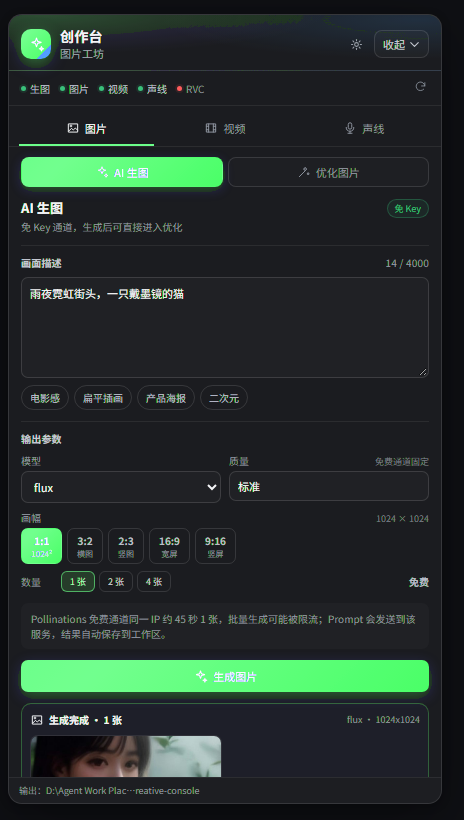
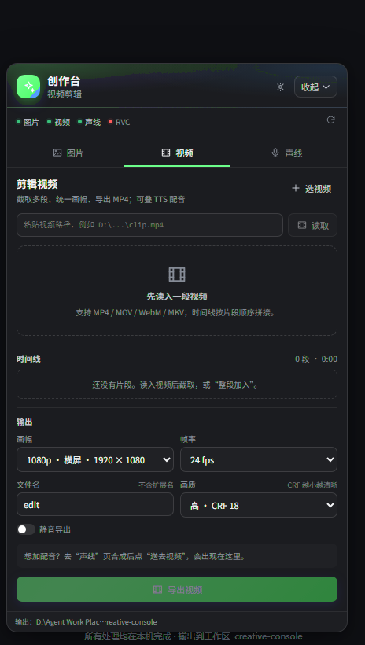
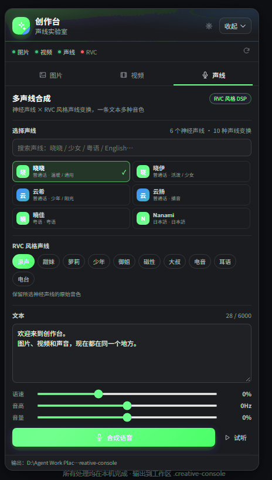

# MuRaSame 创作助手


> 制作者：丛雨不善言辞
MuRaSame 创作助手：左侧栏可折叠的 DSH 多模态创作控制台：**AI 生图 / 生成图优化 / 多段视频剪辑 / 多声线 TTS 与 RVC 风格声线**，全部在本机完成，不读 DSH 的聊天 Key，不上传素材（生图 Prompt 会发送到你选择的生图服务）。

> 安装后，左侧边缘会出现竖向 MRS 收起栏；点它向右展开整高抽屉。控制台右上角 **收起** 会让抽屉向左滑出，回到这条竖栏。

## 界面预览

| 图片工坊 · AI 生图 | 收起后的左侧竖栏 |
|---|---|
|  |  |

| 视频剪辑 | 声线实验室 |
|---|---|
|  |  |

> 预览由插件真实客户端组件在 React + 浏览器中渲染；实际 DSH 中入口位于左侧栏底部，收起后只留竖向「创作台」把手。

## 功能

### 图片工坊

**AI 生图**

- 免配置可用的 Pollinations 通道（同一 IP 约 45 秒 1 张，免费额度有限）。
- 可切换任意 OpenAI 兼容 `/images/generations`：Base URL、模型列表、默认模型、画幅、质量。
- Key 写入 DSH 凭据（`OPENAI_API_KEY` 或自定义引用名），也支持环境变量；设置页不回显明文。
- 支持 1/2/4 张批量、1:1、3:2、2:3、16:9、9:16 画幅。
- 生成结果自动保存到工作区真实文件，可直接预览、下载、复制路径。
- **生成后一键“优化这张”**：自动带入优化页，继续压缩/转格式/裁切。

**生成图优化**

- 读入 DSH 生成的图片：直接粘贴路径，或从本机选择文件。
- 一键预设：网页轻量、高清保留、社交方图、头像 512。
- 输出 WebP / JPEG / PNG / AVIF；等比缩放或居中裁切；质量、最大宽高可调。
- 可选「轻量增强」（自动对比 + 锐化）与「清除元数据」。
- **AI 超分**：内置 Real-ESRGAN ncnn，可 2×/3×/4× 放大，照片通用 / 二次元插画 / 动画帧三种模型；GPU Vulkan 加速。
- 原图 / 结果对比，显示体积节省比例；结果可复制路径、下载、继续处理。
- 原图永不覆盖，结果写入 `工作区/.creative-console/outputs/images/`；生图结果写入 `outputs/generated/`。

### 视频剪辑

- 读入 MP4 / MOV / WebM / MKV / AVI，显示分辨率、时长、帧率、音轨信息与首帧预览。
- **按描述剪**：输入“保留人物说话、去掉空镜、节奏快一点、总长 30 秒”，插件抽帧交给视觉模型选段，回填时间线，可“应用并导出”。
- **台词级剪辑**：可粘贴 SRT/台词，或配置 ASR API 后点“自动转写”；模型会结合画面与台词选段。
- **方案预览与撤销**：方案先列出每段时间和理由；可以只应用或应用并导出；时间线支持“撤销上一步”。
- **语言剪辑 API**：设置里填 Base URL、视觉模型、Key 环境变量与 Key；兼容 OpenAI Chat Completions 的图片输入格式。
- 多段截取：设置入点/出点后加入时间线，支持上移/下移/删除；也可整段加入。
- 统一输出画幅：1080p 横屏、720p、9:16 竖屏、1:1 方形、跟随原片。
- 帧率 24/25/30/60、CRF 画质、静音导出。
- **字幕直通**：TTS 同时产出 SRT；视频导出可封装为 MP4 `mov_text` 软字幕，也可下载 SRT 单独使用。
- **一键加字幕**：读入视频 + SRT，整片保留原声、直接封装软字幕，不重新编码视频。
- **一键字幕配音**：读入视频 + SRT，逐句 TTS、按每条字幕的起止时间对齐，替换音轨并封装字幕（最多 30 条）。
- **视频截封面**：在任意入点截一帧，直接「优化封面」跳到图片页继续裁切/压缩。
- 后台 FFmpeg 任务 + 进度轮询 + 结果预览/下载。
- **PR 时间线交接**：把当前多段时间线导出为 Premiere 可导入的 FCP XML；只生成文件，**不连接、不读取、不修改正在运行的 Premiere**。
- 输出写入 `工作区/.creative-console/outputs/videos/`；PR XML 写入 `outputs/premiere/`。

### 字幕一键处理

- 视频页的「字幕 · 一键处理」接受 `.srt` 路径，也可以直接使用声线页刚生成的 TTS 字幕。
- 「一键加字幕」：`-c:v copy` + `mov_text`，保留原声，速度快。
- 「一键字幕配音」：逐句 edge-tts → 按 SRT 时长用 `atempo` 适配、静音填充、`adelay` 对齐 → 混成一条配音轨 → 替换原声并封装字幕。
- 单句 TTS 有 60 秒超时和 3 次重试；最多 30 条字幕，避免一次请求跑太久。
- 自动语音识别（视频原声 → SRT）尚未内置；需要先启用 DSH 的「语音输入 / SenseVoice」Bundle，或先用其他工具生成 SRT。

### Premiere 接入方式

**已实现：离线 XML（安全默认）**

- 视频页把片段、入点/出点、顺序、画幅、帧率、原声和 TTS 配音整理成 FCP XML（xmeml v4）。
- 点「PR 时间线」只写一个 `.xml` 文件，不调用 Premiere、不碰当前工程。
- 你在 Premiere 里手动「文件 → 导入」选择该 XML 即可；不满意就丢弃，不影响当前工程。
- 已验证 XML 可解析、文件节点 ID 唯一、`pathurl` 指向真实媒体、视频/音频轨道结构完整。

**未启用：实时桥接（需要你明确授权）**

社区可行路线是 ExtendScript/CEP 或 [Pymiere](https://github.com/qmasingarbe/pymiere)（Python 通过 CEP 面板调 Premiere 的 ExtendScript API），以及 [premiere-pro-mcp](https://github.com/leancoderkavy/premiere-pro-mcp) 这类本地 CEP bridge。它们能直接建序列、导入片段、改工程，但也会真实改动当前 PR 工程，且需要安装 CEP 面板、处理版本差异和撤销策略。

本插件**不会自动连接**。等你说可以时，再单独启用一个“连接 Premiere”开关；默认永远走离线 XML。Adobe 官方 UXP 文档见 [AdobeDocs/uxp-premiere-pro](https://github.com/AdobeDocs/uxp-premiere-pro)。

### 声线实验室

- **20 个 Edge 神经声线**：晓晓、晓伊、云希、云夏、云健、云扬、东北/陕西方言、台湾普通话、粤语、English、日本語等。
- **10 种 RVC 风格声线变换**（本地 FFmpeg DSP）：原声、甜妹、萝莉、少年、御姐、磁性、大叔、电音、耳语、电台。
  - 使用 `rubberband` 同时改变音高与共振峰，比单纯变调更接近“换声线”；再叠加 EQ、压缩、合唱/失真等角色化处理。
- 语速 / 音高 / 音量独立可调；支持先「试听」再正式合成。
- 合成结果可直接播放、下载、复制路径，或一键送去视频页做配音；同时自动生成 **SRT 字幕**。
- **可选本地 RVC 模型**：在设置里配置 RVC 命令模板，并放入 `.pth`（可配 `.index`），即可把 Edge 合成结果继续送进 RVC 推理；模型列表自动扫描。
- **录音转自定义声线**：录音或上传 5—10 秒干声，选目标 DSP 声线（可选本地 RVC 模型）→ 转换试听 → 保存为自定义预设；之后合成 TTS 时可直接选这个预设。
- 自定义预设保存在 `工作区/.creative-console/voices.json`；若保存时选了 RVC 模型，后续使用该预设会自动复用同一模型。
- 自定义预设支持重命名和删除；删除前会确认。
- 输出写入 `工作区/.creative-console/outputs/audio/`。
- 控制台底部「打开所在文件夹」可直接在资源管理器中查看 `outputs/` 成品；接口只允许打开插件自己的输出目录。
- 控制台顶部文件夹图标打开「作品与项目」：最近成品可加入项目；项目可新建、删除、查看条目、打开文件夹、移出条目。项目只保存文件引用，不复制成品。
- 项目每次增删条目都会留下快照（最多 20 版），可点「恢复上一版」回滚。
- 快捷键：`Ctrl+Shift+M` 打开/收起控制台；`Esc` 关闭。
- 生图和语言 API 都提供「测试连接」；语言测试会发一个 1 token 的真实请求。

## Agent 工具

插件把创作能力注册成 DSH Agent 工具，任何会话里的智能体都能直接调用，不需要打开侧栏：

| 工具 | 作用 |
|---|---|
| `creative_image_generate` | 生图（Pollinations / Seedream / SiliconFlow / 通义万相 / OpenAI 兼容） |
| `creative_image_upscale` | Real-ESRGAN AI 超分 2/3/4× |
| `creative_image_optimize` | 压缩、转格式、裁切、增强 |
| `creative_voice_generate` | edge-tts 多声线配音 + SRT |
| `creative_video_export` | 多段剪辑、画幅统一、配音、软字幕 |
| `creative_video_plan` | 按自然语言描述分析视频并给出剪辑时间段 |
| `creative_subtitle_apply` | 一键加字幕 / 一键字幕配音 |
| `creative_premiere_xml` | 导出 PR 可导入 FCP XML（不碰 PR） |
| `creative_media_status` | 检查本机引擎与默认 Provider |

对话里可以直接说：

```text
帮我把这张图 AI 超分 4 倍，再压成 WebP：D:\...\cover.png
用晓晓的甜妹声线给这段文案配音，再加到视频里
把这三段视频剪成 9:16，加字幕，导出 PR XML
```

这是“工具化智能体”：模型自己决定调用哪个工具、按什么顺序组合，而不是固定按钮流程。若需要独立人格/独立预设（例如“创作总监”预设、固定系统提示词和工具白名单），可以在此工具层之上再加一个 Agent preset。

## 环境要求

| 能力 | 依赖 | 自动检测位置 |
|---|---|---|
| AI 生图 | Pollinations / Seedream / SiliconFlow / 通义万相 / OpenAI 兼容 | 控制台「设置 → 生图通道」 |
| 图片优化 | Python + Pillow | DSH 自带 Python；也可在设置里指定 |
| AI 超分 | Real-ESRGAN ncnn + Vulkan GPU | 插件内置 `bin/realesrgan/`，也可在设置里指定 |
| 语言剪辑 | OpenAI 兼容视觉模型 | 设置里填 Base URL / 模型 / Key；需支持图片输入 |
| 语音转写 ASR | OpenAI 兼容 `/audio/transcriptions` | 设置 → 高级选项 → 语音转写 ASR；可选 |
| 视频 / 声线 DSP | FFmpeg（建议 6+，本项目验证 9.0.2） | `工作区/tools/ffmpeg.exe`、PATH、设置 |
| TTS | edge-tts | DSH 自带 Python 的 `Scripts/edge-tts.exe`、PATH、设置 |
| RVC（可选） | 本地 RVC 推理器 + `.pth` 模型 | 命令模板 + 工作区 `.creative-console/rvc/models/` |

> Windows 上部分安全软件会拦截 FFmpeg 写 `C:\Users\...`。本插件默认把输出放到**当前 DSH 工作区**，既避开该限制，也方便在文件管理器里找到成品；可用 `DSH_CREATIVE_CONSOLE_HOME` 覆盖。

## 生图通道

设置页默认只显示三块常用项：**生图、语言剪辑、本机引擎**。模型列表、Key 变量名、默认画幅/质量、ffmpeg/python 路径和 RVC 都在右上角「高级选项」里，日常只需要选 Provider 和粘贴 Key。

默认是 **Pollinations（免 Key）**，开箱即可试；免费额度约每 IP 45 秒 1 张。

想用自己的模型，打开控制台右上角 **齿轮 → 生图通道**，直接选 Provider：

| Provider | 默认 Base URL | 默认模型 | 说明 |
|---|---|---|---|
| Pollinations | `https://image.pollinations.ai` | `flux` | 免 Key，额度有限 |
| Seedream / 火山方舟 | `https://ark.cn-beijing.volces.com/api/v3` | `doubao-seedream-3-0-t2i-250415` | 也支持 `doubao-seedream-4-0-250828` |
| SiliconFlow / 硅基流动 | `https://api.siliconflow.cn/v1` | `Kwai-Kolors/Kolors` | 也支持 FLUX.1-schnell、SD3.5 |
| 通义万相 / DashScope | `https://dashscope.aliyuncs.com` | `wanx2.1-t2i-turbo` | 异步任务，插件自动轮询 |
| OpenAI / 自定义兼容 | `https://api.openai.com/v1` | `gpt-image-1` | 任意 `/images/generations` 兼容服务 |

- Base URL 不含 `/images/generations`；Seedream 填到 `/api/v3`，通义填到域名即可。
- 模型列表用逗号分隔，默认模型必须是列表中的一个。
- 填 Key 环境变量名（默认 `OPENAI_API_KEY`），再粘贴 Key 点“保存 Key”；Key 写入 DSH 凭据，设置页不回显明文。
- Seedream 会自动带 `response_format: b64_json` 与 `watermark: false`；SiliconFlow 会自动改用 `image_size` + `batch_size`；通义万相走异步 `task_id` 轮询。
- 其他 OpenAI 兼容服务沿用 `{ model, prompt, n, size }`，支持返回 `{ data: [{ b64_json | url }] }` 或直接返回图片字节。
- 如果当前是 Pollinations，生图卡片里点 **“用自己的 API · 填 Key”** 会立即切到 OpenAI 兼容并展开接口/模型/Key，不需要先保存。

## 语言剪辑 API

视频页的「按描述剪」需要支持图片输入的模型。设置 → 语言剪辑，Provider 可选：

| Provider | Base URL | 默认模型 | 视觉 |
|---|---|---|---|
| OpenAI / 通用兼容 | `https://api.openai.com/v1` | `gpt-4o-mini` | ✓ |
| DeepSeek V4.1 / Flash | `https://api.deepseek.com/anthropic` | `deepseek-flash` | ✓ 自动走 Anthropic Messages，可读图 |
| 通义千问 Qwen-VL | `https://dashscope.aliyuncs.com/compatible-mode/v1` | `qwen-vl-max` | ✓ |
| SiliconFlow 视觉 | `https://api.siliconflow.cn/v1` | `Qwen/Qwen2.5-VL-72B-Instruct` | ✓ |
| 智谱 GLM-4V | `https://open.bigmodel.cn/api/paas/v4` | `glm-4v-plus` | ✓ |
| 自定义兼容 | 自填 | 自填 | 取决于模型 |

> DSH 里的 `DeepSeek-V4.1-Flash` 支持图片输入。插件会看 Base URL：含 `/anthropic` 自动走 Anthropic Messages（`/v1/messages` + `x-api-key`），否则走 OpenAI Chat Completions。选 DeepSeek 时默认 Base 是 `/anthropic`；如果你的网关是 OpenAI 兼容，把 Base 改成 `/v1` 并按需换模型名。

## MuRaSame Agent preset

独立 preset 位于 `D:\DSH-Plugins\murasame-preset`，安装：

```text
plugin_manager.install_bundle("D:/DSH-Plugins/murasame-preset")
```

安装后新建会话时选择 **MuRaSame 创作助手**。它有自己的 persona，优先调用 `creative_*` 工具，并把“素材路径、长任务步骤、不虚构成品、心理测评不做诊断”写进系统提示。现有 standard preset 不受影响。

## 安装

本机已通过 DSH 的插件管理器热安装：

```text
plugin_manager.install_bundle("D:/DSH-Plugins/dsh-creative-console")
```

手动安装时，把本目录加入 profile 的 `dsh.profile.bundles`，或在 Plugin 页面选择本地目录。插件声明了：

```json
"dsh": {
  "bundle": { "patch": "./cordis.patch.yml" },
  "client": { "platform": "web", "inject": ["@deepseek-ai/dsh-client-ui-sidebar"] }
}
```

宿主端注册 `/api-ext/creative-console/*`，客户端注册 `sidebar.footer.action`。

## 使用

1. 刷新页面（或重启 DSH）后，点左侧边缘的竖向 **创作台** 栏；抽屉向右展开。
2. 生图：图片页选「AI 生图」→ 写 Prompt / 选画幅 → 生成 → 点结果上的「优化这张」继续后期。
3. 图片优化：粘贴生成图路径 → 读取 → 选预设 → 开始优化。
4. AI 超分：读入图片后选「AI 超分」模型与 2/3/4 倍率 → 生成 → 可继续优化/下载。
5. 视频：读取视频 → 设置入点/出点 → 加入时间线（可多段）→ 选画幅 → 导出。
6. 声线：选神经声线 + 声线变换 → 输入文本 → 合成；需要配音时点「送去视频」，字幕会一起带上。
7. 视频：可「截封面」并一键去图片页优化；导出时可勾选「封装软字幕」。
8. 右上角 **收起** 让抽屉向左滑出，回到左侧竖栏；点外部或 Esc 也会收起。

## RVC 接入（可选）

1. 把模型放到：

```text
<工作区>/.creative-console/rvc/models/your-model.pth
<工作区>/.creative-console/rvc/models/your-model.index   # 可选
```

2. 在控制台「设置 → RVC 命令模板」填写推理命令，或设置环境变量 `DSH_RVC_CMD`。支持占位符：

```text
{input} {output} {model} {modelPath} {modelName} {index} {indexPath} {pitch} {python}
```

示例（按你本地 RVC 仓库的实际 CLI 参数调整）：

```text
python infer_cli.py --input_path {input} --opt_path {output} --model {model} --index {index} --pitch {pitch}
```

3. 返回声线页，模型会出现在「本地 RVC 模型」下拉框；不选模型时仅使用内置 DSP 声线。

> 内置「RVC 风格声线」是本地 DSP 音色变换，不需要 RVC 引擎；真正的 RVC 模型推理需要你自己的推理器与模型授权。

## 目录与数据

```text
<工作区>/.creative-console/
  outputs/generated/   # AI 生图原图
  outputs/images/      # 优化后的图片
  outputs/upscaled/    # AI 超分结果
  outputs/videos/
  outputs/premiere/    # Premiere FCP XML
  outputs/audio/
  uploads/
  tmp/                 # 自动清理 24 小时前的临时文件
  assets.json          # 最近成品索引
  config.json          # 引擎路径 / 生图通道 / RVC 模板
  voices.json          # 录音转换保存的自定义声线
  projects.json        # 项目与成品引用
  rvc/models/          # 可选 RVC 模型
```

## HTTP 接口

仅供本机同源页面调用，所有路由都做同源检查：

```text
POST /api-ext/creative-console/status
POST /api-ext/creative-console/image/generate
POST /api-ext/creative-console/image/key
POST /api-ext/creative-console/image/inspect
POST /api-ext/creative-console/image/optimize
POST /api-ext/creative-console/image/upscale
POST /api-ext/creative-console/video/inspect
POST /api-ext/creative-console/video/frame
POST /api-ext/creative-console/video/export
POST /api-ext/creative-console/video/plan
POST /api-ext/creative-console/video/transcribe
POST /api-ext/creative-console/asr/key
POST /api-ext/creative-console/video/premiere
POST /api-ext/creative-console/subtitle/inspect
POST /api-ext/creative-console/subtitle/apply
POST /api-ext/creative-console/audio/inspect
POST /api-ext/creative-console/tts
POST /api-ext/creative-console/voice/convert
POST /api-ext/creative-console/voice/preset
POST /api-ext/creative-console/voice/preset/rename
POST /api-ext/creative-console/voice/preset/delete
POST /api-ext/creative-console/api/test
POST /api-ext/creative-console/projects/list
POST /api-ext/creative-console/projects/create
POST /api-ext/creative-console/projects/update
POST /api-ext/creative-console/projects/restore
POST /api-ext/creative-console/projects/delete
POST /api-ext/creative-console/open-folder
POST /api-ext/creative-console/upload
POST /api-ext/creative-console/job/status
POST /api-ext/creative-console/settings
GET  /api-ext/creative-console/asset/:id
GET  /api-ext/creative-console/asset/:id?download=1
```

## 已验证

- Pillow 12.3.0：2400×1600 PNG → 1600×1067 WebP，体积降低 67.5%。
- 生图：Pollinations 真实生成 580×1015 JPEG，随后「优化这张」转 WebP，体积再降 60.8%。
- AI 超分：Real-ESRGAN x4plus 实测 320×240 → 1280×960（RTX 5070 Ti / Vulkan，数秒），输出 PNG 正常落盘。
- FFmpeg 9.0.2：单段 720p 导出、双段 1080×1920 竖屏 + TTS 混音导出，均成功并可从插件接口回读元数据。
- edge-tts 7.3.1：晓晓 / 云希等声线，`甜妹` / `少年` DSP 变换成功；输出 MP3 可播放，并同步生成 SRT。
- 字幕/封面：TTS 实测产出 4.68 秒音频 + 130 B SRT；带字幕视频导出成功，MP4 内含 `mov_text` 字幕轨；视频 1.2s 处截封面成功。
- 一键字幕：3 条 SRT 软封装成功；2 条 SRT 逐句配音成功，输出同时含配音音轨与 `mov_text` 字幕轨。
- 客户端：jsdom + React 19 验证生图 → 结果卡片 → “优化这张”切换、设置页、引擎状态点，以及左向折叠/把手展开。
- Premiere：真实导出 2.1 秒时间线的 FCP XML；XML 解析通过，文件 ID 唯一，`pathurl` 指向可用媒体，视频/音频轨道完整。未对运行中的 Premiere 发起任何调用。
- 宿主：workspace 解析到 `D:\Agent Work Place`，输出固定到 `.creative-console`，不写 C:。

## 已知限制

- Pollinations 免费通道同一 IP 约 45 秒 1 张，批量生成可能返回 `FREE_LIMIT`；换 OpenAI 兼容通道或稍后重试。
- OpenAI 兼容通道需要模型与中转支持 `/images/generations`；`gpt-image-1` 的质量参数仅对支持它的模型发送。
- 视频软字幕使用 MP4 `mov_text`，播放器需支持字幕轨；不做烧录字幕（当前 FFmpeg 构建不含 libass）。
- SRT 时间轴来自 edge-tts 的逐句切分，适合旁白；需要逐字对齐时请用专业字幕工具。
- 一键字幕配音最多 30 条；单句合成失败会重试 3 次，仍失败则整次中止。
- 自动语音识别未内置；视频原声转 SRT 需启用 DSH 语音输入/SenseVoice Bundle 或外部 ASR。
- PR 时间线不包含转场/调色/特效，只交接剪辑点和音轨。
- 视频导出一次一个 FFmpeg 任务；长视频按 FFmpeg 速度计时。
- 浏览器上传单文件约 80 MB；更大的文件请直接填本机路径。
- AVIF 依赖 Pillow 的编码支持；不支持时会明确报错，可改用 WebP。
- AI 超分依赖可用的 Vulkan GPU；无 Vulkan 的机器会报错。当前只处理单张图片，不批量超分视频帧。
- DSP 声线不是神经网络声音克隆；高质量、指定角色音色请接本地 RVC 模型。
- 图片增强是轻量对比/锐化，不做 AI 超分。

## License

MIT
